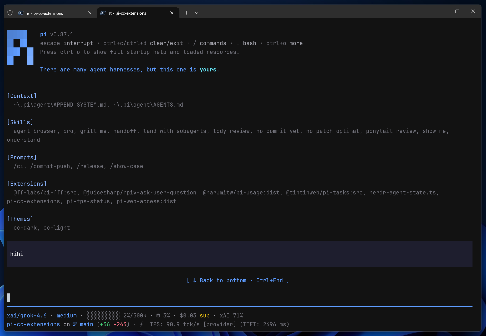

<p align="center">
  <a href="./README.md">简体中文</a> · <strong>English</strong>
</p>

# pi-cc-extensions

> Claude Code-style TUI output with some personal touches and handy utilities (no extra built-in tools).

## Preview

<a href="https://github.com/user-attachments/assets/6c858000-fdad-43f9-957f-4d0278648498"></a>

Click the cover to play the demo video

## Quick start

```bash
pi install npm:pi-cc-extensions

# GitHub
pi install git:github.com/minuque/pi-cc-extensions
```

Run `/reload` after installation.

## Features

| Feature                     | Description                                                                                                                                  | Entry point                                     |
| --------------------------- | -------------------------------------------------------------------------------------------------------------------------------------------- | ----------------------------------------------- |
| Claude Code UI              | Tool summaries, expand/collapse, rich edit/write diffs, and `on` / `compact` / `off` modes                                                   | `/ccstyle`                                      |
| Markdown enhancements       | Mermaid dialects in non-standard fences (`statediagram`, `classdiagram`…) and circled-number conversion; plain mermaid goes to pi | Automatic; turn off with `enableMarkdownEnhance: false` |
| Fullscreen mode             | Tool card/group expand and collapse on click, previews, hover highlight, and a back-to-bottom button                                         | `--tui-mode fullscreen` (default since pi 1.5) |
| Settings panel              | `Style / Features / UI / Diff / Thinking / Footer` tabs                                                                                      | `/ccstyle`                                      |
| Context inspection          | Usage breakdown and previews for the system prompt, memory, skills, tools definition, and messages                                           | `/context`                                      |
| Transcript browsing         | Full-screen transcript browsing with every tool output expanded; the key goes to pi while a long `!` output can be expanded                  | `Ctrl+O`                                        |
| Session/Subagent references | Search and inject effective context from previous Sessions or existing SubAgents                                                             | `@`                                             |
| Status bar                  | Shows model, context, cache, cost, the conversation token total, and git; also works with `@narumitw/pi-usage` for live quota. Git/cache/token Nerd Font icons can be turned off | `/ccstyle`                                      |
| Theme                       | Bundled themes: CC Dark, CC Light, CC Dark HC, CC Light HC                                                                                   | `/settings` → Theme                             |

Renderer snapshots for `on` / `compact` modes: [default](./docs/tool-render-examples-default.md) · [compact](./docs/tool-render-examples-compact.md)

## Configuration

`/ccstyle` behavior is configured through `~/.pi/agent/pi-cc-extensions.json`:

```jsonc
{
  // style
  "mode": "on",                            // on / compact / off
  "excludeRenderers": [],                  // tools keeping the native renderer, matched case-insensitively; Agent always keeps its dedicated renderer

  // features
  "enableSessionReference": true,          // @ session references
  "enableSubagentAutocomplete": true,      // @subagent:[name] completion and delegation hints
  "enableContextCommand": true,            // /context usage check
  "enableAgentSummary": true,              // per-turn tool summary
  "enableWorkingMessage": true,            // Working... bottom token/elapsed
  "enableAliases": true,                   // /clear, /exit aliases
  "enableMarkdownEnhance": true,           // markdown pass: Mermaid dialects and circled-number conversion; false hands it to other extensions
  "enableEditorPrefix": true,              // editor ❯ prefix

  // ui
  "expandedInputMaxLines": 5,              // expanded tool Input lines; overflow shows a footer hint
  "expandedOutputMaxLines": 10,            // expanded tool Output lines; overflow shows a footer hint
  "expandedPreviewMaxLines": 40,           // max lines for expanded TaskList bodies (expanded diffs always show all)
  "toolLabelClip": 0,                      // tool summary path/command clip length; 0 = fit width
  "showStartupHeader": true,               // startup header (logo + tips) toggle
  "stickyUserMessage": true,               // fullscreen: pin a user message's first line once it scrolls off the top edge, until the next one takes over
  "scrollButtonMode": "dock",              // fullscreen: extension dock row / native Pi floating overlay

  // diff
  "diffViewMode": "auto",                  // layout: auto / split / unified
  "diffIndicatorMode": "bars",             // change indicators: bars / classic / none
  "diffSplitMinWidth": 120,                // min terminal width for side-by-side columns
  "editDiffCollapsedLines": 24,            // edit collapse lines; 0 = change-count summary only
  "writeDiffCollapsedLines": 0,            // write collapse lines; 0 = creation summary only
  "diffWordWrap": true,                    // wrap long diff lines

  // thinking
  "useSummaryTitlesAsThinkingTitle": true, // use latest summary as thinking title
  "previewLines": 3,                       // preview lines while thinking; 0 hides
  "completedPreviewLines": null,           // completed preview lines; null follows previewLines, 0 hides. Panel accepts any number or follow
  "animationIntervalMs": 90,               // title animation interval (ms)

  // footer
  "enableCustomFooter": true,              // custom status bar
  "footerTokenRate": true,                 // output rate chip; false hides it
  "footerTokenRateMode": "average",        // average: whole-prompt avg; live: trailing 1s rate
  "footerTokenRateTtft": true,             // append TTFT to the rate chip; false shows tok/s only
  "footerSessionTokens": false,            // conversation token total chip (Nerd Font glyph, Σ in plain text); sums usage.totalTokens from session entries. Off by default
  "footerCurrency": "USD",                 // display currency for the footer cost
  "footerCurrencyRate": null,              // display units per 1 cost unit; null changes the symbol only
  "footerNerdIcons": true,                 // Nerd Font glyphs for git/cache/tokens; false = plain text
  "footerGitStatsMode": "working",         // working (default): uncommitted; branch: cumulative net changes
  "footerContextLimit": "window",          // context chip limit: window (default); compaction: auto-compaction point (window − compaction.reserveTokens); both: compaction point, window in brackets
                                           // Pi compacts only after crossing that point, so the text can briefly exceed 100% (e.g. 104%/184k); the bar clamps at 100%
  "footerHiddenKeys": [],                  // hidden chip keys
  "footerLine1Keys": ["model", "context", "cache", "rate", "cost", "tokens", "pi-usage"], // chip order per line; builtins and plugins share one layout
  "footerLine2Keys": ["cwd", "git"],       // cwd: directory and session; git: branch and changes. Either can move to any line
  "footerLine3Keys": [],                   // painted only when a chip is visible
}
```

> [!TIP]
> **Fullscreen**: expanded diffs always show every line. When expanded Input/Output exceeds the line cap, the footer shows `… +N more lines`; click for the full preview, click again to collapse.

> [!NOTE]
> **Mermaid rendering**: set `markdown.mermaid` to `final` (`/settings`) so it renders once instead of every frame.

## Local development

```bash
./test.sh            # macOS/Linux; needs node and pi
./test.bat           # Windows; runs test.sh through Git Bash
pi -e .              # one run, does not edit settings.json
```

## Compatibility

- Node.js `>=22.19.0`, Pi `^1.5.1` (uses the injected keybinding hints, `messageTypes` and `ctx.ui.custom({ blocked })` from pi 1.5.x)

## Recommended companions

| Extension                                | Purpose                                                     |
| ---------------------------------------- | ----------------------------------------------------------- |
| `npm:pi-web-access`                      | Web search, URL fetching, GitHub cloning, PDF/video parsing |
| `npm:@narumitw/pi-usage`                 | Current-account usage for Codex / Copilot / OpenRouter      |
| `npm:@juicesharp/rpiv-ask-user-question` | Multiple-choice questionnaire the model can ask you         |

## Credits

- Rich diffs are adapted from [`MasuRii/pi-tool-display`](https://github.com/MasuRii/pi-tool-display) (MIT). See [`extensions/renderer/tool/diff/ATTRIBUTION.md`](./extensions/renderer/tool/diff/ATTRIBUTION.md).

## License

[MIT](./LICENSE) © minuque
